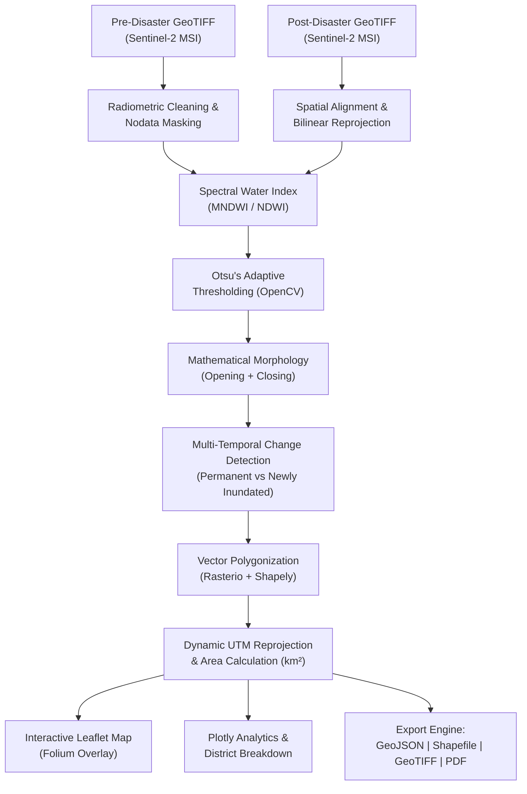

# 🛰️ GeoInundate – Automated Satellite Water Inundation & Disaster Change Detection System

[](https://www.python.org/downloads/)
[](https://streamlit.io)
[](https://opensource.org/licenses/MIT)
[](https://sentinels.copernicus.eu/web/sentinel/missions/sentinel-2)
[](https://geopandas.org/)

**GeoInundate** is an autonomous, open-source geospatial remote sensing and disaster change detection system designed to monitor, segment, and quantify flood water inundation from multi-temporal optical satellite imagery (Sentinel-2 MSI).

The platform transforms raw pre-disaster and post-disaster satellite observations into actionable emergency response intelligence: calculating spectral water indices (**MNDWI** / **NDWI**), determining optimal water cutoffs via **Otsu’s adaptive thresholding**, vectorizing flood polygons into true projected area metrics ($\text{km}^2$), and generating interactive multi-layered Leaflet maps alongside downloadable PDF assessment reports and GIS layers.

---

## 🌟 Key Features

- **Multi-Temporal Satellite Ingestion:**
  - Automated CRS, spatial resolution, transform, and bounding box inspection.
  - Multi-band Sentinel-2 L2A support (Green B03, NIR B08, SWIR1 B11).
  - Radiometric reflectance scaling ($0\text{–}10,000 \rightarrow 0.0\text{–}1.0$) and invalid/nodata masking.
  - Automatic grid alignment and reprojection between pre- and post-disaster rasters.

- **Spectral Water Index Computation:**
  - **MNDWI (Xu, 2006):** $\frac{\text{Green} - \text{SWIR}}{\text{Green} + \text{SWIR}}$ — suppresses built-up land and bare soil noise.
  - **NDWI (McFeeters, 1996):** $\frac{\text{Green} - \text{NIR}}{\text{Green} + \text{NIR}}$ — classic surface water delineation.
  - Numerical division-by-zero protection and spatial resolution harmonization (e.g. 20m SWIR resampled to 10m Green).

- **Automated Flood Segmentation:**
  - Global bimodal **Otsu's adaptive thresholding** implemented via OpenCV.
  - Morphological opening (noise speckle elimination) and closing (hole sealing).
  - Connected component size filtering to discard spurious single-pixel artifacts.
  - Multi-temporal classification disaggregating **Permanent Water**, **Newly Inundated Land**, and **Receded Water**.
  - Manual threshold override option for advanced analysts.

- **Geospatial Vectorization & Metric Integrity:**
  - Raster-to-polygon vectorization with topological geometry repair (`make_valid`, `buffer(0)`).
  - **True projected area calculation:** Automatically validates CRS and transforms vector layers to local **Universal Transverse Mercator (UTM)** or equal-area projections before computing square kilometres. Eliminates latitude distortion errors.
  - Administrative boundary overlay calculating flood impact per district/municipality.

- **Interactive Geospatial Dashboard:**
  - Responsive Streamlit interface with dark GIS theme.
  - Folium & Leaflet interactive map with layer controls, fullscreen toggle, measurement tool, and custom legend.
  - Interactive Plotly analytics: area comparisons, landscape composition donut charts, and spectral index histograms.

- **Export & Reporting:**
  - **Publication-grade PDF Flood Assessment Report** generated with ReportLab.
  - **WGS84 GeoJSON** vector polygons.
  - **ESRI Shapefile ZIP** archive (`.shp`, `.shx`, `.dbf`, `.prj`).
  - **Georeferenced GeoTIFF** classification mask.
  - Structured Markdown disaster summary.

---

## 🏗️ System Architecture



---

## 🔬 Scientific Methodology

### 1. Modified Normalized Difference Water Index (MNDWI)
Water features typically absorb strongly in the shortwave-infrared (SWIR) region while reflecting moderately in visible green wavelengths:

$$\text{MNDWI} = \frac{\rho_{\text{Green}} - \rho_{\text{SWIR}}}{\rho_{\text{Green}} + \rho_{\text{SWIR}}}$$

For Sentinel-2:
- **Green ($\rho_{\text{Green}}$):** Band 3 ($\lambda = 560\text{ nm}$, native resolution $10\text{ m}$)
- **SWIR1 ($\rho_{\text{SWIR}}$):** Band 11 ($\lambda = 1610\text{ nm}$, native resolution $20\text{ m}$)

Because built-up features and soil have higher reflectance in SWIR than in Green, MNDWI yields negative values for urban environments, dramatically reducing urban false alarms compared to McFeeters' NIR-based NDWI.

### 2. Otsu's Adaptive Thresholding
Rather than applying an arbitrary static cutoff (e.g., $0.0$), Otsu’s algorithm minimizes intra-class variance (or equivalently maximizes inter-class variance $\sigma_B^2$):

$$\sigma_B^2(t) = \omega_0(t) \omega_1(t) \left[\mu_0(t) - \mu_1(t)\right]^2$$

Where $\omega_0, \omega_1$ denote class probabilities and $\mu_0, \mu_1$ denote class mean values for water and non-water candidates.

### 3. Projected Coordinate Metric Verification
Calculating square kilometres directly from decimal degrees (EPSG:4326) yields severe geometric distortion depending on latitude ($\cos(\text{latitude})$ factor). GeoInundate computes the geographic centroid of the scene and reprojects vectors to the corresponding UTM Zone (e.g. `EPSG:32643`) where coordinates are strictly Euclidean meters, ensuring high physical measurement accuracy.

---

## 📂 Repository Structure

```
GeoInundate/
├── app.py                     # Streamlit multi-page web application
├── config.py                  # Global configurations, bands, styling, and thresholds
├── requirements.txt           # Python dependency specifications
├── packages.txt               # Debian/Ubuntu system libraries (GDAL, GEOS, PROJ)
├── README.md                  # Comprehensive documentation and technical manual
├── .gitignore                 # Standard Python/geospatial ignore patterns
├── processing/
│   ├── __init__.py
│   ├── raster_loader.py       # GeoTIFF loading, CRS validation, and reprojection
│   ├── spectral_indices.py    # MNDWI & NDWI calculations and color mapping
│   ├── flood_detection.py     # Otsu thresholding, morphology, change detection
│   ├── vectorization.py       # Mask-to-polygon conversion and GIS exporters
│   ├── area_calculation.py    # UTM projection and square kilometre calculations
│   └── sample_generator.py    # Bundled Sentinel-2 sample dataset synthesizer
├── visualization/
│   ├── __init__.py
│   ├── map_view.py            # Folium interactive geospatial map with layer controls
│   ├── charts.py              # Plotly analytics, histograms, and donut charts
│   └── report_generator.py    # PDF and Markdown report generator
├── data/
│   └── sample/                # Sample pre/post Sentinel-2 GeoTIFFs and admin GeoJSON
├── outputs/                   # Export directory for generated GeoJSON/Shapefiles
├── assets/
│   ├── style.css              # Custom GIS dashboard CSS styles
│   └── logo.svg               # Vector brand logo
└── tests/
    ├── __init__.py
    └── test_pipeline.py       # Pytest unit and integration test suite
```

---

## 🚀 Installation & Local Execution

### Prerequisites
- Python 3.10 or 3.11 recommended.
- Git.

### 1. Clone the Repository
```bash
git clone https://github.com/aditi789soni/GeoInundate.git
cd GeoInundate
```

### 2. Create and Activate Virtual Environment
```bash
# On Linux / macOS
python3 -m venv venv
source venv/bin/activate

# On Windows (PowerShell)
py -3.10 -m venv venv
.\venv\Scripts\Activate.ps1
```

### 3. Install Dependencies
```bash
pip install --upgrade pip
pip install -r requirements.txt
```

### 4. Run the Test Suite
```bash
pytest tests/ -v
```

### 5. Launch the Streamlit Web Application
```bash
streamlit run app.py
```
Open your browser at `http://localhost:8501`.

---

## 🖥️ Application Walkthrough

1. **Quick Start:** Click **"🚀 Load Sample Flood Dataset"** in the sidebar. The system automatically loads pre- and post-disaster Sentinel-2 imagery, runs the full analysis pipeline, and populates all tabs.
2. **Satellite Ingestion:** Upload custom pre- and post-disaster GeoTIFF rasters and optional administrative boundaries (GeoJSON / Shapefile).
3. **Pre/Post Comparison:** Inspect side-by-side false-color infrared composites to visually spot water expansion.
4. **Spectral Water Index:** View high-contrast MNDWI images and explore the bimodal histogram with Otsu cutoff markers.
5. **Flood Detection:** Examine separate permanent baseline water and newly flooded land masks. Adjust Otsu vs manual sliders as needed.
6. **Impact Statistics:** Review high-level KPI cards (inundated $\text{km}^2$, percent of scene, flood patch counts) and district breakdown charts.
7. **Interactive Flood Map:** Toggle layers in Folium (inundation polygons, permanent water, change raster, administrative boundaries).
8. **Download Results:** Download official PDF assessment reports, GeoJSON polygons, Shapefile ZIPs, or GeoTIFF masks.

---

## ☁️ Deployment Guide

### Deploying to Streamlit Community Cloud (Recommended)
1. Fork or push this repository to GitHub.
2. Sign in to [share.streamlit.io](https://share.streamlit.io/).
3. Click **"New App"** and select repository `aditi789soni/GeoInundate`.
4. Set Main file path to: `app.py`.
5. Streamlit Cloud automatically detects `requirements.txt` and `packages.txt` (which installs GDAL/GEOS libraries on Linux).
6. Click **Deploy**. The app will be publicly available with zero login required.

---

## ⚠️ Limitations & Considerations

- **Cloud Cover:** Optical satellite sensors (Sentinel-2) cannot penetrate cloud cover or heavy cloud shadows. For flood events under persistent overcast conditions, pairing with Synthetic Aperture Radar (SAR, e.g. Sentinel-1 GRD) is recommended.
- **Vegetation Canopy:** Dense vegetation canopy can obstruct standing water detection in optical wavelengths.
- **Spatial Resolution:** Sentinel-2 optical bands have a spatial resolution of 10m to 20m. Urban drainage issues or narrow ditches smaller than 10m may not be resolved.

---

## 📄 License
This project is licensed under the MIT License - see the LICENSE file for details.
